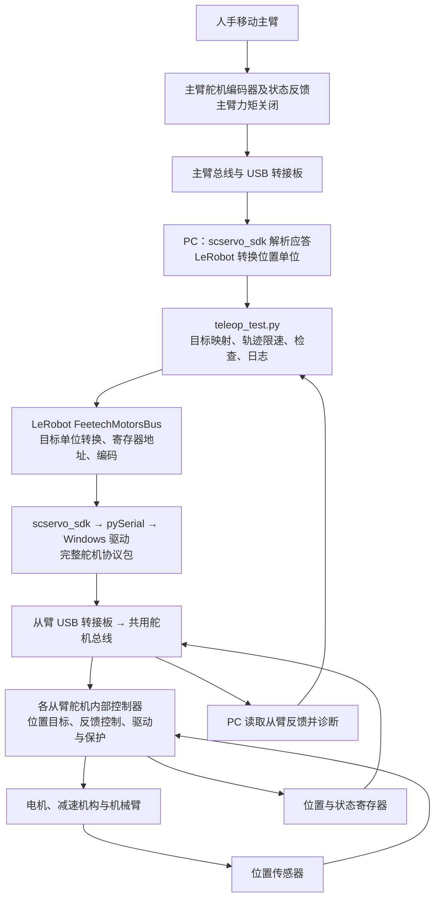

# SO-ARM101 控制链与校准流程

核实日期：2026-10-13。对象：本仓库的一主臂、一从臂幻尔 SO-ARM101 实验；本地控制脚本以提交 `4136797` 为基准。核实范围包括控制代码和公开硬件资料。

## 1. 控制链概览

当前遥操作的调用链是：**`teleop_test.py` → LeRobot 的 SO101 对象和 `FeetechMotorsBus` → `scservo_sdk` → pySerial → Windows 串口驱动 → USB 舵机转接板 → 舵机总线 → 各舵机内部控制器。**

各组件的关系如下：

1. **`scservo_sdk` 由 `feetech-servo-sdk` 包提供。** LeRobot 直接调用该模块。幻尔 SDK 是独立通信库，当前实验未使用。
2. **当前 USB 路径是否包含 STM32 应用程序，尚未确认。** 厂商的 BusLinker STM32 示例采用外接 STM32 主机，通过 TTL 接口连接转接板。
3. **PC 发送关节位置目标，舵机内部执行电机反馈控制。** LeRobot 将 PID 参数写入舵机寄存器。HX 固件的控制算法、频率、芯片与源码仍未确认。

软件部分依据下文的固定版本源码；硬件接口依据[幻尔 SO-ARM101 手册的硬件清单](https://docs.hiwonder.com/projects/LeRobot/en/latest/docs/SO_ARM101_Open_Source_6_Axis_Robotic_Arm_User_Manual.html#hardware-list)、[BusLinker USB/TTL 接口说明](https://docs.hiwonder.com/projects/BusLinker/en/latest/docs/1_BusLinker_V3.0_Servo_Debugging_Board_User_Manual.html#interface-description)和[外接 STM32 接线说明](https://docs.hiwonder.com/projects/BusLinker/en/latest/docs/3_STM32_Development.html#wiring-instruction)。本机板卡修订与芯片型号尚未通过板上丝印、原理图确认。



图中舵机内部闭环按公开功能描述，具体实现待核实。两只臂分别有 USB 串口与 ID 1–6；主臂 ID 1 与从臂 ID 1 位于不同总线，由 PC 程序建立关节对应关系。

## 2. 组件版本、来源与职责

本次采用锁定的 PyPI 发行包源码进行核对，未连接硬件。LeRobot 的 `feetech.py` 与 `v0.6.1` 标签文本一致；SDK 的 `protocol_packet_handler.py` 与下列版本提交文本一致。本文结论对应这些固定版本。

| 层 | 核实版本 / 来源 | 作者或维护者 | 运行位置与职责 |
| --- | --- | --- | --- |
| 本地实验代码 | [teleop_test.py](teleop_test.py)、[calibrate_arm.py](calibrate_arm.py)、[hardware.py](hardware.py) | 本仓库维护者 | PC Python：选择设备、安排启动/停止、映射主从、限制目标轨迹、诊断、日志与备份 |
| LeRobot | `0.6.1`；标签提交 `7e241bd630a3719a56157a497ce5d08f244784f1` | Hugging Face LeRobot 团队及贡献者；Apache-2.0 | PC Python：机器人对象、关节定义、校准、单位转换、总线抽象 |
| `scservo_sdk` | PyPI `feetech-servo-sdk==1.0.0`；仓库标签 `v.1.0.0`，提交 `5d25bbe8300858a032ee568e5abed2a184f1d840` | 原始 FEETECH SDK；Adam-Software / vertigra 分发维护 | PC Python：帧格式、指令、校验和、应答解析、串口事务 |
| pySerial | `3.5` | pySerial 项目；BSD | PC Python：调用操作系统串口 API，读写字节 |
| 幻尔 SDK，供比较 | `Hiwonder-official/hiwonder-servo-sdk`，提交 `5b0807f6e8fc0469e7bde6115be78c57779dfcb6` | Hiwonder-official；README 声明 MIT | Python 或外接 MCU：另一套 HX 舵机协议客户端；当前未安装、未调用 |
| Windows USB 串口驱动、板卡电子电路 | 厂商资料指定 CH341 串口驱动；本机芯片修订未确认 | 芯片/板卡供应商 | 让 COM 口的字节进入舵机 UART/TTL 总线；公开资料不足以列出全部内部实现 |
| HX 舵机内部固件 | 本次未找到可核实的固件源码发布 | 厂商或其供应链；具体开发团队未知 | 舵机内：处理寄存器目标、采样反馈、驱动电机、更新状态、保护 |

来源：[本环境依赖](pyproject.toml)、[完整锁文件](uv.lock)、[LeRobot 固定标签](https://github.com/huggingface/lerobot/tree/v0.6.1)、[SDK 1.0.0 发布包](https://pypi.org/project/feetech-servo-sdk/1.0.0/)、[SDK 分发仓库与原始来源说明](https://github.com/Adam-Software/Feetech-Servo-SDK/tree/5d25bbe8300858a032ee568e5abed2a184f1d840)、[FEETECH 官方资料入口](https://ftservo.github.io/ftservo-wiki/downloads/)、[幻尔 SDK 快照](https://github.com/Hiwonder-official/hiwonder-servo-sdk/tree/5b0807f6e8fc0469e7bde6115be78c57779dfcb6)。

已确认公开的代码包括 PC 侧 Python 调用链和外接 STM32 通信示例。Windows 厂商驱动、BusLinker 内部实现及 HX 舵机固件的开源状态尚未确认。厂商提供的协议和 MCU 客户端代码覆盖主机通信部分。

厂商旧配套 LeRobot 包基于 `0.3.4`，此前检查见[配套源码检查](vendor-source-review.md)。它与本环境的上游 `0.6.1`、此次独立核实的幻尔 SDK 是三个不同对象。

## 3. 本地实验代码

| 文件 / 函数 | 输入 | 工作和输出 |
| --- | --- | --- |
| `hardware.resolve_port()`，39 行 | `leader` / `follower` | 根据 USB 序列号匹配当前 COM 口，识别主从角色 |
| `hardware.probe()`，46 行 | 指定臂 | 直接调用 SDK 的 ping/read，检查 ID 1–6、型号码 777、位置、力矩与模式；不写寄存器 |
| `hardware.read_motor_status()`，12 行 | 已打开的 SDK 端口 | 逐个读取地址 40 起的 31 字节，保留通信结果和舵机错误位；解析原始目标、位置、电流等 |
| `calibrate_arm.main()` | 臂角色、既有 JSON | 只读预检查、备份、仅连接总线、调用 LeRobot 校准、回读比对、关闭端口 |
| `teleop_test.position()`，64 行 | LeRobot 设备对象 | 读取原始位置，先检查编码器及校准范围，再用 LeRobot `_normalize()` 转换单位 |
| `teleop_test.requested_positions()`，76 行 | 主臂位置、从臂初始位置、可选关节 | 全臂跟随，或仅指定关节跟随，其余关节保持从臂启动目标 |
| `teleop_test.targets()`，43 行 | 请求、上次目标、边界、间隔、速度上限 | 限制目标范围及每次目标增量，输出本次目标和限幅原因 |
| `verify_startup_goals()`，100 行 | 从臂当前原始位置 | 确认所有关节力矩关闭，逐关节有应答写目标，再逐关节精确回读；全部一致才继续 |
| `release_follower_torque()`，126 行 | 从臂总线 | 恢复 SDK 软件忙标志，逐关节尝试写关力矩，某关节失败仍尝试其余关节 |
| `teleop_test.main()`，145 行 | 命令参数、两臂校准 | 组织预检查、启动、约 60 Hz 循环、异常停止与 JSONL 日志 |

遥操作程序读取主臂实测关节位置，生成从臂下一帧的位置目标。舵机内部控制器根据目标和反馈位置计算电机驱动输出。

## 4. LeRobot 设备与总线实现

### 4.1 SO101 设备对象与关节配置

`SO101Leader` 是 `SOLeader` 的别名，`SO101Follower` 是 `SOFollower` 的别名。两个构造函数定义相同的六个关节及 ID 1–6，给每个关节配置模型键 `sts3215`，再创建 `FeetechMotorsBus`。本地配置设置 `use_degrees=True`，前五关节用度，夹爪用 0–100 归一化单位。

模型键 `sts3215` 用于选择寄存器表、编码方式、4096 分辨率与握手型号预期。本机通信记录的型号返回值是 777；实物系列、减速比、板内芯片及 HX 固件来源仍需单独核实。

`Robot` / `Teleoperator` 基类按 `calibration_dir / (id + '.json')` 加载和保存校准。本地脚本为两臂分别指定设备 ID 和校准目录。

源码：[SOLeader 构造](https://github.com/huggingface/lerobot/blob/v0.6.1/src/lerobot/teleoperators/so_leader/so_leader.py#L39)、[SOFollower 构造](https://github.com/huggingface/lerobot/blob/v0.6.1/src/lerobot/robots/so_follower/so_follower.py#L46)、[Robot 校准文件](https://github.com/huggingface/lerobot/blob/v0.6.1/src/lerobot/robots/robot.py#L151)、[Feetech 模型表](https://github.com/huggingface/lerobot/blob/v0.6.1/src/lerobot/motors/feetech/tables.py)。

上游常规接口包括 `leader.get_action()` 读位置、`follower.get_observation()` 读状态/相机、`follower.send_action()` 写目标。本地诊断脚本直接调用 `device.bus`，保留原始位置并执行逐步检查和日志记录。

`SOFollower.send_action()` 的可选 `max_relative_target` 按“目标与测得当前位置的差”限幅，默认 `None`。当前脚本调用的是自己的 `targets()`；此前会造成回向问题的 5° 相对位置限幅已移除。详情见[复测记录](CALIBRATION.md#遥操作限幅问题与复测结论)。

### 4.2 FeetechMotorsBus 寄存器读写

`FeetechMotorsBus.__init__()` 依赖 `feetech-servo-sdk`，以 `import scservo_sdk as scs` 导入，创建 `PortHandler`、`PacketHandler`、`GroupSyncRead` 与 `GroupSyncWrite`。它还替换 SDK 的包超时计算，修正该 PyPI 分发版本的已知问题。

`SerialMotorsBus.connect()` 开串口并握手；Feetech 握手检查关节型号和同一总线内固件版本一致性。`bus.connect()` 的操作范围限于通信连接。普通 `follower.connect()` 随后还会校准、连接相机和调用 `configure()`。本地脚本分别调用这些步骤，以控制参数配置和力矩启用的顺序。

以下名称、地址和宽度取自当前 `sts3215` 寄存器表：

| 名称 | 十进制地址 / 十六进制 | 字节 | 当前作用 |
| --- | --- | --- | --- |
| `Min_Position_Limit` / `Max_Position_Limit` | 9 / `0x09`；11 / `0x0B` | 各 2 | 校准范围写入与回读 |
| `Phase` | 18 / `0x12` | 1 | bit 4 控制驱动所假定的反馈模式 |
| `P_Coefficient` / `D_Coefficient` / `I_Coefficient` | 21 / `0x15`；22 / `0x16`；23 / `0x17` | 各 1 | 将位置控制参数写给舵机 |
| `Homing_Offset` | 31 / `0x1F` | 2 | 零位偏移；符号幅值编码的符号位为 bit 11 |
| `Operating_Mode` | 33 / `0x21` | 1 | 本程序用 0，即位置模式 |
| `Torque_Enable` | 40 / `0x28` | 1 | 开/关输出力矩 |
| `Acceleration` | 41 / `0x29` | 1 | 舵机侧加速度参数 |
| `Goal_Position` | 42 / `0x2A` | 2 | 下发关节目标位置 |
| `Goal_Time` / `Goal_Velocity` | 44 / `0x2C`；46 / `0x2E` | 各 2 | 当前循环没有更新这两个寄存器 |
| `Lock` | 55 / `0x37` | 1 | 配置区锁定/解锁 |
| `Present_Position` | 56 / `0x38` | 2 | 读当前反馈位置 |
| 电压 / 温度 / 状态 / 电流 | 62 / `0x3E`；63 / `0x3F`；65 / `0x41`；69 / `0x45` | 1 / 1 / 1 / 2 | 当前诊断读取，日志保留原始值 |

读写还由父类 `SerialMotorsBus` 实现：

| 调用 | 实际处理 |
| --- | --- |
| `read()` | 查名称对应的地址/宽度 → SDK 单舵机读取 → 检查通信与舵机错误 → 解符号 → 位置按需归一化 |
| `write()` | 位置按需反归一化 → 符号编码 → 拆成字节 → SDK `writeTxRx()` → 检查应答 |
| `sync_read()` | 建立 ID 列表 → SDK `GroupSyncRead.txRxPacket()` → 收各 ID 数据 → 解码及归一化 |
| `sync_write()` | 将关节目标转成原始整数 → 编码、拆字节、加入各 ID → SDK `GroupSyncWrite.txPacket()`；没有逐舵机应答 |

源码：[SDK 构造与超时补丁](https://github.com/huggingface/lerobot/blob/v0.6.1/src/lerobot/motors/feetech/feetech.py#L76)、[连接与断开](https://github.com/huggingface/lerobot/blob/v0.6.1/src/lerobot/motors/motors_bus.py#L514)、[寄存器表](https://github.com/huggingface/lerobot/blob/v0.6.1/src/lerobot/motors/feetech/tables.py#L35)、[单写](https://github.com/huggingface/lerobot/blob/v0.6.1/src/lerobot/motors/motors_bus.py#L1067)、[同步读](https://github.com/huggingface/lerobot/blob/v0.6.1/src/lerobot/motors/motors_bus.py#L1128)、[同步写](https://github.com/huggingface/lerobot/blob/v0.6.1/src/lerobot/motors/motors_bus.py#L1221)。

## 5. SDK 依赖与通信协议

### 5.1 名称与依赖关系

```text
当前路径：LeRobot → feetech-servo-sdk 1.0.0 提供的 scservo_sdk → pySerial
比较路径：用户应用 → 幻尔 hiwonder-servo-sdk 的 HiwonderBus / Servo → pySerial
MCU 示例：外接 STM32 应用 → 幻尔 STM32 通信库 → HAL_UART_Transmit / Receive
```

幻尔 Python `HiwonderBus` 独立实现 `_build_packet()`、`_send()`、`_recv()`，直接调用 pySerial。`Servo.move_to()` 写地址 `0x2A` 起的 6 字节位置、时间、速度块；`sync_move()` 通过同步写给多舵机发目标。这些代码运行在主机端，负责舵机协议通信。

两套 SDK 具有相同的基本帧头、校验和及读/写/同步写指令。完整兼容性仍需逐项核对 API、寄存器表和控制语义。本文比较对象为 HX 舵机 SDK；幻尔 LX 舵机库和机器人板卡库属于其他产品接口。

源码：[幻尔 Python 底层组包](https://github.com/Hiwonder-official/hiwonder-servo-sdk/blob/5b0807f6e8fc0469e7bde6115be78c57779dfcb6/python/hiwonder/servo.py#L66)、[move_to](https://github.com/Hiwonder-official/hiwonder-servo-sdk/blob/5b0807f6e8fc0469e7bde6115be78c57779dfcb6/python/hiwonder/servo.py#L237)、[STM32 UART 发送](https://github.com/Hiwonder-official/hiwonder-servo-sdk/blob/5b0807f6e8fc0469e7bde6115be78c57779dfcb6/stm32/hiwonder_servo_stm32.c#L65)。

**寄存器定义差异：** 幻尔该快照将位置 P 定义为 `0x16`、2 字节，LeRobot 当前表为 `0x15`、1 字节；幻尔 `torque_enable()` 通过修改其定义的最大力矩寄存器实现，LeRobot 写 `Torque_Enable=0x28`；幻尔将电压 `0x3E` 定义为 2 字节，同时将温度定义在紧邻的 `0x3F`，与当前一字节电压表不一致。差异原因尚未确认，可能涉及固件版本、文档或 SDK 实现。替换库前需要取得与本机固件匹配的协议表，并核对寄存器回读。

对照：[幻尔 Reg 定义](https://github.com/Hiwonder-official/hiwonder-servo-sdk/blob/5b0807f6e8fc0469e7bde6115be78c57779dfcb6/python/hiwonder/servo.py#L12)、[幻尔 torque_enable](https://github.com/Hiwonder-official/hiwonder-servo-sdk/blob/5b0807f6e8fc0469e7bde6115be78c57779dfcb6/python/hiwonder/servo.py#L322)、[LeRobot STS 表](https://github.com/huggingface/lerobot/blob/v0.6.1/src/lerobot/motors/feetech/tables.py#L35)。

### 5.2 scservo_sdk 组包、解析与错误处理

`protocol_packet_handler.txPacket()` 补 `FF FF` 帧头，计算校验和，通过 `PortHandler.writePort()` 发送。`rxPacket()` 搜索帧头，检查长度、接收超时及校验和。单舵机 `readTxRx()` / `writeTxRx()` 返回数据、通信结果、舵机错误位。

SDK 返回两类状态：`COMM_RX_TIMEOUT`、`COMM_RX_CORRUPT` 等主机通信结果，以及应答 error 字节中的舵机报警。报警包括电压、角度、温度、电流和过载。收到带报警的应答说明舵机已响应，同时报告异常。

此 SDK 的 `GroupSyncRead.rxPacket()` 用 `_` 丢弃各舵机应答的 error 字节，LeRobot 同步读的返回值也省略了该字段。本地诊断因此增加逐舵机状态读取，保留 `packet_error`。同步写采用广播，无逐舵机应答；目标接收情况需要寄存器回读，运动完成情况需要位置反馈。

源码：[组包与解析](https://github.com/Adam-Software/Feetech-Servo-SDK/blob/5d25bbe8300858a032ee568e5abed2a184f1d840/scservo_sdk/protocol_packet_handler.py#L69)、[同步读错误字节处理](https://github.com/Adam-Software/Feetech-Servo-SDK/blob/5d25bbe8300858a032ee568e5abed2a184f1d840/scservo_sdk/group_sync_read.py#L58)、[同步写](https://github.com/Adam-Software/Feetech-Servo-SDK/blob/5d25bbe8300858a032ee568e5abed2a184f1d840/scservo_sdk/group_sync_write.py#L66)。

### 5.3 协议帧与字节示例

当前帧结构是：

```text
请求：FF FF | ID | LENGTH | INSTRUCTION | PARAMETERS... | CHECKSUM
应答：FF FF | ID | LENGTH | ERROR       | DATA...       | CHECKSUM
```

`LENGTH = 参数字节数 + 2`，包含 instruction/error 和 checksum。校验和是从 ID 到参数末尾各字节之和按位取反，保留低 8 位。两个字节的目标位置按低字节在前编码。

以下数据由锁定 SDK 在纯内存端口生成，未打开 COM 口或向机器人发送：

```text
向 ID 1 写 Goal_Position=2047（地址 42）：
FF FF 01 05 03 2A FF 07 C6

向 ID 1–6 同步写 Goal_Position=2047：
FF FF FE 16 83 2A 02 01 FF 07 02 FF 07 03 FF 07 04 FF 07 05 FF 07 06 FF 07 03

同步读取 ID 1–6 的 Present_Position（地址 56，长度 2）：
FF FF FE 0A 82 38 02 01 02 03 04 05 06 26
```

第一包中 `03` 是写，`2A` 是寄存器地址，`FF 07` 是整数 2047；第二包 `FE` 是广播，`83` 是同步写，`02` 是每个 ID 的数据宽度。协议包包含舵机 ID、寄存器地址与原始目标值。

本地及 LeRobot 传入 `PacketHandler(0)`。SDK 工厂参数 `protocol_end` 用于设置字节序；`getProtocolVersion()` 返回 `1.0`。该参数的具体含义以工厂函数和字节编码实现为准。见[PacketHandler 工厂](https://github.com/Adam-Software/Feetech-Servo-SDK/blob/5d25bbe8300858a032ee568e5abed2a184f1d840/scservo_sdk/packet_handler.py#L7)及[字节序函数](https://github.com/Adam-Software/Feetech-Servo-SDK/blob/5d25bbe8300858a032ee568e5abed2a184f1d840/scservo_sdk/scservo_def.py)。

### 5.4 pySerial 与操作系统串口接口

`PortHandler.setupPort()` 打开 1,000,000 baud 串口，8 数据位；pySerial 默认无奇偶校验、1 停止位。SDK `writePort()` / `readPort()` 调用 `serial.Serial.write()` / `read()`，Windows 后端经 Win32 串口 API 和驱动传输字节。

本版本的 `clearPort()` 调用 `self.ser.flush()`，等待待发送数据完成。`reset_input_buffer()` 用于丢弃接收缓冲，SDK 在打开端口时调用。退出恢复还会复位 `is_using`；它是 SDK 内存中的串口事务忙标志。

来源：[PortHandler](https://github.com/Adam-Software/Feetech-Servo-SDK/blob/5d25bbe8300858a032ee568e5abed2a184f1d840/scservo_sdk/port_handler.py#L31)、[pySerial 3.5 Windows 后端](https://github.com/pyserial/pyserial/blob/v3.5/serial/serialwin32.py#L303)、[flush 与 reset_input_buffer 的 API 定义](https://pyserial.readthedocs.io/en/latest/pyserial_api.html#serial.Serial.flush)。

## 6. 校准流程与参数

校准范围包括手动关节参考姿态、零位偏移和活动范围。PID 整定、相机标定、连杆参数辨识及编码器工厂校准需使用各自的流程。

### 6.1 执行步骤

1. `calibrate_arm.py` 识别 USB 身份，检查力矩关闭并备份已有 JSON。调用 `bus.connect()` 握手，再备份舵机当前偏移和限位。
2. 调用 LeRobot `calibrate()`。已有 JSON 时，直接 Enter 会把旧参数写回并结束；输入 `c` 才重新测量。
3. 重校准先 `disable_torque()`：写 `Torque_Enable=0` 与 `Lock=0`，再将工作模式设为位置模式。
4. 手动将所有关节摆到参考中间姿态，按 Enter。`set_half_turn_homings()` 清除旧偏移，把范围暂设为 0–4095，读取当前位置，计算并写新偏移。
5. 手动移动五个关节通过机械活动范围；`record_ranges_of_motion()` 反复读取位置、累积最小/最大值，直到 Enter。循环未结束时约有 20 ms 休眠，实际采样周期还包括串口读耗时。
6. `wrist_roll` 参与参考姿态和偏移设置，活动范围直接设为 0–4095。装配后的可转范围仍受线材约束。
7. LeRobot 写 `Homing_Offset`、`Min_Position_Limit`、`Max_Position_Limit`，更新总线内存中的校准，保存每关节的 `id / drive_mode / homing_offset / range_min / range_max` 为 JSON。
8. `calibrate_arm.py` 检查 `bus.is_calibrated`，回读偏移与范围对比文件，随后关闭端口。流程保持力矩关闭，未写运动目标。中断可能留下部分已修改的参数；恢复需另行处理备份。

源码：[SOFollower.calibrate](https://github.com/huggingface/lerobot/blob/v0.6.1/src/lerobot/robots/so_follower/so_follower.py#L115)、[SOLeader.calibrate](https://github.com/huggingface/lerobot/blob/v0.6.1/src/lerobot/teleoperators/so_leader/so_leader.py#L84)、[清旧参数与半圈偏移](https://github.com/huggingface/lerobot/blob/v0.6.1/src/lerobot/motors/motors_bus.py#L754)、[记录范围](https://github.com/huggingface/lerobot/blob/v0.6.1/src/lerobot/motors/motors_bus.py#L803)、[写入和回读比较](https://github.com/huggingface/lerobot/blob/v0.6.1/src/lerobot/motors/feetech/feetech.py#L228)。操作说明和既有实机结果见[CALIBRATION.md](CALIBRATION.md)。

### 6.2 零位偏移与位置单位转换

LeRobot 对此型号假定的舵机反馈约定是“反馈位置 = 实际位置 − homing offset”。设清除偏移后的读数为 $r_0$，计算的偏移为 $h$：

$$
h = r_0 - 2047
$$

例如参考姿态读数 2500，则写偏移 453，期望该姿态反馈为 2047。这是 LeRobot 的实现约定；HX 在所有反馈模式、跨圈情况下的精确处理仍需要固件协议验证。见[偏移公式源码](https://github.com/huggingface/lerobot/blob/v0.6.1/src/lerobot/motors/feetech/feetech.py#L278)。

日常读取 `Present_Position` 已得到舵机的反馈值 $r$，PC 不再重复减一次偏移。旋转关节用校准范围中点 $m$ 转成度：

$$
m = \frac{r_{\min}+r_{\max}}{2},\qquad
q = (r-m)\frac{360}{4095},\qquad
r_{\text{goal}} = \operatorname{int}\left(q_{\text{goal}}\frac{4095}{360}+m\right)
$$

参考姿态的反馈值被设为 2047，PC 的 0° 则对应活动范围中点 $m$；两者重合的条件是 $m=2047$。两臂分别用各自的校准将位置转为 $q$，再以同名关节对应。范围采集会影响主从机械姿态的对应关系。

夹爪的 `drive_mode=0` 时是：

$$
g = 100\frac{\operatorname{clip}(r,r_{\min},r_{\max})-r_{\min}}{r_{\max}-r_{\min}}
$$

$g$ 表示校准开合范围的百分比。反转换按同一范围映射并取整数。旋转关节的度模式按上述线性公式转换，机械范围约束由本地 `targets()` 函数执行。见[归一化与反归一化](https://github.com/huggingface/lerobot/blob/v0.6.1/src/lerobot/motors/motors_bus.py#L854)。

回读检查比较文件与偏移、范围寄存器的一致性。范围扫描会拒绝最小值等于最大值的结果，机械行程仍需人工检查。本机主臂肘部上限 4106 的待复核记录见操作说明。

## 7. 遥操作控制流程

### 7.1 启动配置与力矩启用

1. 构建设备对象、加载两臂 JSON；校准项须完整且有效范围足够宽。`--dry-run` 到此返回，不打开串口。
2. 直接 SDK 只读预检查，随后 `bus.connect()`；检查力矩、校准回读及 `Phase` bit 4。主从放到相近姿态，人确认后才继续。
3. `leader.configure()` 保持主臂力矩关闭。读取从臂当前原始位置，`verify_startup_goals()` 有应答写入全部当前目标并逐个精确回读，避免旧目标在使能力矩后生效。
4. `follower.configure()` 使用 `bus.torque_disabled()` 上下文：先关力矩/解锁，配置结束在 `finally` 中开力矩/锁定；配置中途异常也可能进入开启过程。脚本在调用前设置 `may_hold_torque=True`，使退出处理覆盖部分启动失败。

LeRobot 配置具体写入：返回延迟 0、最大加速度与加速度 254、必要时清 `Phase` bit 4；从臂位置模式 0，以及默认 P=16、I=0、D=32；夹爪额外写最大力矩 500、保护电流 250、过载力矩 25。这些数值按寄存器原始参数解释，其单位和增益缩放待固件资料确认。主臂配置保持原有 PID 参数。

源码：[SOFollower.configure](https://github.com/huggingface/lerobot/blob/v0.6.1/src/lerobot/robots/so_follower/so_follower.py#L159)、[PID 默认配置](https://github.com/huggingface/lerobot/blob/v0.6.1/src/lerobot/robots/so_follower/config_so_follower.py#L40)、[torque_disabled 的 finally](https://github.com/huggingface/lerobot/blob/v0.6.1/src/lerobot/motors/motors_bus.py#L677)、[通信和加速度配置](https://github.com/huggingface/lerobot/blob/v0.6.1/src/lerobot/motors/feetech/feetech.py#L209)。

### 7.2 每帧位置读取与目标下发

当前 `main()` 循环依次做：

1. 依次读取主臂和从臂的原始位置并转换。两臂读取存在时间差。
2. 得到请求位置；单关节模式下其余关节使用启动保持目标。
3. 约每 0.5 秒逐舵机读取从臂状态，包含目标寄存器；检查报警、力矩和读错误。
4. 检查读耗时、位置跳变、主臂请求与从臂实测位置差；越界则退出，不发送这一帧目标。
5. 将请求夹在从臂校准范围与 0–4095 交集向内 24 刻度的边界，沿**上次发送的目标**推进轨迹。
6. 调用 `follower.bus.sync_write('Goal_Position', row['sent'])`。LeRobot 将度/夹爪单位转换为 raw；SDK 发广播同步写；每个舵机根据自己的 ID 更新目标并执行内部控制。
7. 记录原始反馈、归一化位置、请求、下发目标、限幅原因与耗时；按 60 Hz 请求周期休眠。真实频率从日志判断。

目标轨迹公式，$b_k$ 是经过范围限制的请求，$u_{k-1}$ 是上次发出的目标：

$$
u_k = u_{k-1} + \operatorname{clip}(b_k-u_{k-1},-v_{\max}\Delta t,v_{\max}\Delta t)
$$

程序采用的 $\Delta t$ 最多 50 ms。默认旋转关节 60°/s，夹爪 50 单位/s。目标轨迹从上次发送值继续推进，从臂暂时停住时仍可更新目标。该限制作用于命令轨迹变化率；实际机械速度取决于舵机控制和负载，碰撞检测需另行实现。

诊断检查包括：原始编码值须在 0–4095，观测可容忍校准端点外 32 刻度；读取处理超过 200 ms 拒绝旧目标；逐帧位置变化超过 20 单位停止；请求与从臂反馈相差超过 40 单位停止并采集状态。旋转关节使用度，夹爪使用归一化单位。以上阈值属于本实验配置。

日志 `sent` 记录发送前的浮点目标，SDK 随后将其量化为整数。`goal_position_raw` 记录定期回读的目标寄存器值，位置字段记录实测反馈。诊断时需结合请求、下发目标、目标回读、实际位置和报警；同步写的每帧接收情况仍缺少完整回读记录。

### 7.3 结束与通信中断

正常结束、Ctrl+C 或异常后，若程序可能开启过力矩，就逐关节尝试 `Torque_Enable=0`，每个关节请求前调用 `clearPort()` 并复位 `is_using=False`；单关节失败不阻断其他请求。最后关闭两臂端口、保存日志与失败信息。

退出处理通过串口发送关力矩请求，关闭 COM 口时舵机寄存器仍保持原值。请求失败时，力矩释放状态待确认。板卡或舵机的通信失联看门狗行为也尚未核实。

## 8. BusLinker 接口与 STM32 示例

厂商 SO-ARM101 清单列出两块 BusLinker V3.0。BusLinker 手册给出 USB/TTL 选择引脚、USB 串口、外接微控制器串口和单线 TTL 舵机接口，并要求 PC 连接时选择 USB。手册指定 CH341SER 驱动，本机具体芯片型号待核实。

**源码确认：** PC 直接发送包含舵机 ID、指令与寄存器地址的舵机协议包。当前客户端调用链中未出现独立的 STM32 应用接口。

**功能推断：** USB 接法中，转接板承担主机串口与舵机单线总线之间的传输适配，电源由板卡分配。板侧提供物理接口适配及通信方向处理；具体电路、内部芯片和实现方式待原理图或源码确认。

**外接 STM32 实现：** 幻尔 STM32 文档将独立 `STM32F103RBT6` 板通过串口引脚接到 BusLinker，选择 TTL。示例一个 UART 向 PC 打印调试数据，另一个 1 Mbps UART 通信舵机。主机应用运行在外接 STM32 上：公开 C SDK `_send()` 调 `HAL_UART_Transmit()`，`_recv()` 调 `HAL_UART_Receive()` 并校验应答，完成舵机协议通信。

```text
当前 USB 模式：PC Python + SDK → USB 串口转接板 → 舵机总线
外接 MCU 模式：STM32 应用 + MCU 通信 SDK → UART/TTL 转接接口 → 舵机总线
```

来源：[USB/TTL 切换及接口](https://docs.hiwonder.com/projects/BusLinker/en/latest/docs/1_BusLinker_V3.0_Servo_Debugging_Board_User_Manual.html#interface-description)、[STM32 外接及 UART 分工](https://docs.hiwonder.com/projects/BusLinker/en/latest/docs/3_STM32_Development.html)、[公开 STM32 通信源码](https://github.com/Hiwonder-official/hiwonder-servo-sdk/blob/5b0807f6e8fc0469e7bde6115be78c57779dfcb6/stm32/hiwonder_servo_stm32.c)。

外接主机、转接板和舵机内部控制器属于三个硬件位置。厂商示例明确给出了外接主机的 STM32 型号；另外两个位置的芯片型号尚未确认。

## 9. HX 固件功能与开源控制参考

### 9.1 HX 公开功能与待核实实现

幻尔 HX-30HM 产品特性列出 12 位磁编码器、梯形加减速、PID 及位置/温度/电压反馈。BusLinker 手册提供位置 PID、速度闭环参数和保护配置。这些资料支持舵机内部执行反馈控制的功能描述。

HX 固件的调度、中断、控制方程、增益缩放、抗积分饱和、滤波、PWM 生成、MCU 型号和源码仍缺少公开资料。控制环结构、FOC 使用情况、闭环频率、掉线行为、保护状态机及开发团队归属均待核实。

来源：[HX-30HM 产品特性](https://www.hiwonder.com/products/hx-30hm)、[BusLinker 位置与速度 PID 界面说明](https://docs.hiwonder.com/projects/BusLinker/en/latest/docs/1_BusLinker_V3.0_Servo_Debugging_Board_User_Manual.html#reading-and-configuring-servo-information)。产品页部分展开文字混入 HX-10HM 描述，本文仅采用明确标注 HX-30HM 的顶部特性。

### 9.2 SimpleFOC 位置控制源码参考

开源参考采用 SimpleFOC `v2.3.5` 的 BLDC 位置控制实现，说明位置目标、反馈计算和 PWM 输出之间的调用关系。该实现仅供控制算法参考；HX 的电机类型和 FOC 使用情况仍待核实。SimpleFOC 的传感器对齐、电角度初始化与本实验的关节范围校准分别处理不同参数。

在配置为 `MotionControlType::angle` 时，已核实的调用关系是：

| 位置 | 源码里的具体工作 |
| --- | --- |
| 应用循环调用 `motor.move(target)` | 更新目标；读取轴角和轴速度；用 `P_angle(target - shaft_angle)` 得到速度目标并限制速度 |
| 同一 `move()` | `PID_velocity(velocity_target - shaft_velocity)` 得到电流或电压意义的控制目标，含义取决于转矩控制模式 |
| 应用循环调用 `motor.loopFOC()` | 更新传感器；计算电角度；若启用电流反馈模式，采样电流并通过电流控制器得到电压分量 |
| `setPhaseVoltage()` | 按选定调制方式把电压分量变成相电压，调用驱动 `setPwm()` |
| `BLDCDriver3PWM::setPwm()` | 相电压除以供电电压，限制为占空比，再调用平台 `_writeDutyCycle3PWM()` 写硬件 PWM |
| `PIDController::operator()` | 根据实际时间间隔计算比例、积分、微分；限制积分、总输出及可选输出变化率，保存上次误差和积分 |

直接源码：[BLDCMotor.move 位置分支](https://github.com/simplefoc/Arduino-FOC/blob/v2.3.5/src/BLDCMotor.cpp#L438)、[loopFOC](https://github.com/simplefoc/Arduino-FOC/blob/v2.3.5/src/BLDCMotor.cpp#L337)、[setPhaseVoltage](https://github.com/simplefoc/Arduino-FOC/blob/v2.3.5/src/BLDCMotor.cpp#L499)、[PID 实现](https://github.com/simplefoc/Arduino-FOC/blob/v2.3.5/src/common/pid.cpp#L17)、[占空比与硬件 PWM](https://github.com/simplefoc/Arduino-FOC/blob/v2.3.5/src/drivers/BLDCDriver3PWM.cpp#L77)。

其 PID 的离散计算可写为下式；然后还要做源码中的限幅和输出变化率处理：

$$
P_k = K_p e_k,\qquad
I_k = I_{k-1}+K_i\frac{\Delta t}{2}(e_k+e_{k-1}),\qquad
D_k = K_d\frac{e_k-e_{k-1}}{\Delta t},\qquad
u_k=P_k+I_k+D_k
$$

内部控制器循环采样反馈、计算误差并更新驱动输出。PC 的目标更新周期和内部控制周期独立，HX 内部频率待核实。本机配置 I=0，位置控制仍使用 P、D 参数及其他固件运动逻辑。

## 10. ACT 策略接口

当前遥操作的目标来源为主臂实测位置。后续采用 ACT 时，`ACTPolicy.predict_action_chunk()` 根据配置的图像与机器人状态预测一段动作，`select_action()` 从动作队列或时间集成结果取当前动作；推理运行在 PC。针对本实验的 SO101 位置动作接口，策略输出经数据归一化/反归一化、特征映射和执行层转换为六关节位置目标。数值含义由训练数据和处理器配置确定。

源码：[ACT 动作队列与预测入口](https://github.com/huggingface/lerobot/blob/v0.6.1/src/lerobot/policies/act/modeling_act.py#L101)。当前 `teleop_test.py` 还没有这段策略接入逻辑。

公开系统的接口对照可参考 Google DeepMind 2026 年 7 月的 Gemini Robotics On-Device 2 模型卡：输入包括文本、图像和机器人本体状态，输出为数值机器人动作。该模型卡描述策略接口，本机 HX 的低层控制仍以对应硬件资料为依据。见[官方模型卡](https://deepmind.google/models/model-cards/gemini-robotics-on-device-2/#model-information)。

## 11. 待核实信息

| 待确认事项 | 所需证据 | 现有资料范围 |
| --- | --- | --- |
| 本机转接板具体型号、修订、芯片与方向电路 | 板卡丝印/原理图、USB VID/PID 和厂商对应资料 | USB 序列号用于设备识别，CH341SER 名称用于驱动安装 |
| HX 的准确寄存器语义与新版 SDK 差异 | 与本机固件版本匹配的官方协议表；既有配置回读 | 当前已核对帧格式、型号返回值和部分寄存器操作 |
| HX 内部 PID、轨迹发生器、传感器处理、PWM | 厂商固件源码或明确算法说明 | 已知公开功能、主机参数写入和 SimpleFOC 参考实现 |
| 舵机内部芯片与固件开发来源 | 芯片型号资料、厂商固件开发/授权声明 | STM32 示例覆盖外接主机端的二次开发 |
| 关力矩、报警、掉线的实机行为 | 在既有实验流程中记录目标/状态回读与机械响应 | 当前代码记录通信结果并执行退出处理，实际响应需实机验证 |
