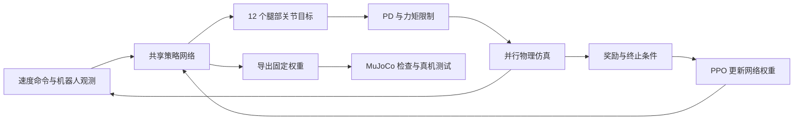

# 仿真强化学习能否用于真实机器人与工业应用：证据审查

调研日期：2026-10-20。研究对象：宇树 `unitree_rl_gym` 的公开 G1 行走流程，以及可用于交叉核实的四足、人形机器人研究和工业部署。本文是公开资料与源码审查，未自行复现训练或测试真机；厂商未公开的训练日志、事故记录和人工介入次数均保留未知。

## 1. 结论与证据强度

**在足式机器人的行走、平衡和部分全身运动控制中，仿真强化学习 → 真机部署已经是一条被多个独立团队采用、并进入工业产品的技术路线。** ANYbotics 明确披露其工业巡检产品的行走策略在仿真中训练、经真机测试后更新到机队；具名客户案例与 SAP 的集成资料进一步证实了实际运行。因此，“工业应用必须通过实机强化学习或遥操作训练才能成立”这一必要条件，与已有公开实现不符。[ANYbotics 技术说明][A1]、[客户案例][A3]、[SAP 集成说明][A4]

但以下判断必须分别成立，不能互相替代：

| 问题 | 本次审查的判断 | 证据能支持的程度 |
| --- | --- | --- |
| 宇树这类训练思路常用吗？ | 在足式运动控制中已被多家研究与产品团队采用 | ETH/ANYbotics、Berkeley、Google DeepMind、Figure、Boston Dynamics 分别公开了相关实现；没有全行业占比统计，不给出市场比例 |
| 仿真训练出来的策略能在真机工作吗？ | 能，存在多项顶级机器人期刊的实机研究 | 涵盖四足和完整尺寸人形机器人；具体地形、扰动、测试时长各有范围 |
| 已用于工业产品吗？ | 四足巡检有较完整证据链；人形也有客户现场运行记录 | 各家工业系统的训练细节公开程度不同，不能统一归为“纯仿真训练” |
| `unitree_rl_gym` 本身达到工业可靠性了吗？ | 公开材料不足以支持 | 官方实机部署说明将该示例定位为演示；未发布工业任务的可靠性与维护统计 |
| 工业应用是否必须进行实机策略参数更新？ | 现有证据不支持这个必要条件 | 仿真中更新策略权重、部署固定权重是已实现的方法；仍然需要真机测量、测试和工程迭代 |
| 是否必须使用遥操作示范？ | 基础行走可以不使用；复杂操作有明确的混合方案 | 速度奖励可训练行走；工业操作也会结合遥操作、人体动作、传统控制和仿真 RL |

这里的“常用”只针对**足式机器人的学习运动控制**。不将这一判断推广成所有工业机器人、所有操纵任务的统一训练方式。支持上述判断的研究与产品证据在第 4—6 节逐项列出。

## 2. 先区分“真实训练”的具体含义

把所有真实世界参与都称为“实机训练”，会混淆这次问题中最关键的区别。

| 环节 | 数据从哪里来 | 更新什么 | 例子 |
| --- | --- | --- | --- |
| 仿真强化学习 | 模拟机器人与模拟环境交互 | 控制策略权重、价值网络权重 | 宇树公开 G1 PPO 训练 |
| 系统辨识／执行器建模 | 真机的指令、编码器、力矩等测量 | 仿真器参数或执行器模型 | 2019 年 ANYmal 的学习执行器模型 |
| 遥操作模仿学习 | 人操纵真实机器人产生的观测与动作 | 任务策略权重 | Agility 披露的示范学习流程之一 |
| 人体动作模仿／重定向 | 人体动作记录，映射到机器人关节或身体 | 动作先验、跟踪策略等 | Figure Helix 02 的 System 0 |
| 实机强化学习／实机数据微调 | 真机执行产生的轨迹与反馈 | 根据真实轨迹更新策略权重；计算可在服务器进行 | 必须有明确披露才能判断某系统是否采用 |
| 真机验证与现场调试 | 真机运行、故障和任务日志 | 可只改变模型选择、配置、仿真模型或任务流程 | ANYmal 发布前测试、客户现场部署 |
| 运行时反馈适应 | 当前传感器与观测历史 | 动作、内部记忆或状态估计；可以保持网络权重固定 | Berkeley Digit 的历史上下文控制 |

这些环节可以组合。**使用了真机数据，并不能据此判定策略在真机上做了强化学习；没有实机策略更新，也不能据此判定整个项目没使用真实测量。** 2019 年 ANYmal 的策略训练与执行器建模就是两个独立的数据与参数更新过程；2024 年 Berkeley Digit 则明确展示了固定网络权重下的上下文适应。[ANYmal 方法正文][P1]、[Digit 方法正文][P4]

本文使用“零样本迁移／zero-shot transfer”时，指相应论文中训练好的策略部署到真机时不再通过真机轨迹更新策略权重。它不承诺整个研发过程从未进行系统辨识、试机、筛选模型或根据失败修改下一轮训练。

## 3. 宇树公开 G1 流程实际做了什么

### 3.1 适用版本与源码定位

本节固定到 `unitree_rl_gym` 提交 `276801e46c5d433564f24658bac64f254b7d2d4b`，与本仓库 G1 课程记录的上游版本一致。以下结论针对这个公开实现，不代表宇树出厂固件、全部商业控制器或后续仓库的实现。

| 代码 | 核实内容 |
| --- | --- |
| [G1 训练配置][U1] | 47 维 actor 观测、50 维 critic 观测、12 维动作、LSTM、奖励和随机化 |
| [G1 环境][U2] | 观测拼接、左右脚相位、脚接触与摆动奖励 |
| [基础环境配置][U3]、[执行循环][U4] | 并行环境、物理步长、动作到 PD 力矩、复位与扰动 |
| [RSL-RL rollout 与更新][U5]、[PPO 实现][U6] | 仿真采样、计算回报、更新神经网络 |
| [G1 实机配置][U7]、[实机执行代码][U8] | 策略加载、观测、12 个腿部目标与 17 个固定目标的下发 |
| [实机部署说明][U9] | 官方对该示例验证状态的明确限定 |

### 3.2 学习信号来自速度目标与奖励

训练环境生成前后、横向与转向速度命令。策略读取机器人状态，输出关节动作；仿真器推进物理状态，奖励函数评价速度跟踪、姿态、存活、关节运动及脚接触。PPO 根据这些交互轨迹更新网络。该公开训练链没有要求输入人的逐步行走示范或实机行走数据集。[G1 环境][U2]、[配置][U1]、[训练循环][U5]

默认基础配置为 4,096 个环境，每轮采集 24 个策略步，因此一轮是 98,304 条并行环境转移；它们用于训练共享策略。PPO 通过奖励与采样概率计算梯度，无须对接触动力学逐步反向传播。[基础配置][U3]、[runner][U5]、[PPO][U6]

### 3.3 网络输入、动作与电机控制

actor 的 47 维输入由机体角速度 3、重力方向 3、速度命令 3、关节位置偏差 12、关节速度 12、前一步动作 12、步态相位正余弦 2 组成。训练 critic 额外读取仿真的机体线速度 3 维；这部分没有直接提供给部署 actor。[观测构造][U2]

该版本 actor 的结构为 `LSTM(47,64) → Linear(64,32) → ELU → Linear(32,12)`。策略每 20 ms 输出一次动作；训练物理步长为 5 ms，每个动作保持四个物理步。[网络配置][U1]、[物理配置][U3]

动作对应的目标角度为：

$$
q_t^{\mathrm{target}}=q^{\mathrm{default}}+0.25a_t.
$$

仿真中的位置控制模式进一步计算并限制关节力矩：

$$
\tau_t=\operatorname{clip}\!\left(K_p(q_t^{\mathrm{target}}-q_t)-K_d\dot q_t,\,-\tau_{\max},\,\tau_{\max}\right).
$$

因此，神经网络承担根据反馈生成关节目标的职责；PD、力矩限制、传感器处理与通信仍承担各自的控制工作。[动作计算][U4]

**“策略输出 12 维”与“实机只给 12 个电机发命令”需要分开。** 此版本 G1 实机配置给 0—11 号腿部电机发送策略生成的目标，同时给 12—28 号腰部与手臂电机发送固定目标，共涉及 29 个电机。后 17 个电机的姿态没有由这个 12 维策略学习生成。课程中的 12 关节模型则把相关上身关节固定在模型中。[实机映射][U7]、[命令生成][U8]；本地来源记录见 `robotics-lab/src/robotics_lab/assets/models/g1/upstream.json`。

要学习主动摆臂、搬运时全身配合或手指操作，需要针对相应机器人与任务设计观测、动作、数据／奖励和训练环境。增加网络输出数量只是其中一项工作；现有权重不会因接入更多电机自动获得对应技能。这是依据当前接口与训练目标作出的工程判断。

### 3.4 为何能尝试迁移，公开示例还缺什么

G1 配置在训练中随机改变摩擦系数、机体质量，并周期性施加扰动。具体范围包括摩擦系数 0.1—1.25、附加机体质量 −1 至 3 kg；代码中的推扰实现是修改机体平面速度。这些设置让策略面对一组动力学差异，但无法仅凭随机化范围证明覆盖了真实机器人全部误差。[G1 配置][U1]、[扰动实现][U4]

需保留三个限制：

1. 类名 `G1RoughCfg` 本身不能证明使用了复杂地形；必须继续检查继承后的实际地形配置。该版本基础配置使用平面。[基础配置][U3]
2. 发布的默认配置与预训练文件，缺少完整训练日志及生成记录时，无法证明该文件恰好由所有默认参数训练得到。
3. 官方实机说明明确说该示例不是稳定控制程序、用途是演示；仓库没有随示例给出工业任务的故障率、人工介入率或长期维护统计。[官方实机说明][U9]

据此，**这套公开代码实现了可研究、可训练、可尝试部署的真实技术链；它的公开验证状态仍然是演示。** 方法的工业有效性需要由后文其他系统的证据核实，不能直接转移成这个 checkpoint 的工业可靠性。

## 4. 顶级期刊中的真机证据及失败条件

本节以已发表的 *Science Robotics* 论文为主要研究证据，核对方法、控制接口和实机实验，而不以论文数量或宣传视频长度判断有效性。公开全文为作者版本时另列正式 DOI；对应的全部实验范围以相应版本正文为准。

这些系统共同采用仿真交互、策略优化及迁移工程，但算法、网络、动作接口与数据来源各有不同。下文的 TRPO、PPO、教师学生和动作模仿说明了同一技术路线中的不同实现；本文没有证据表明这些产品直接运行宇树的公开训练仓库。

### 4.1 ANYmal，2019：仿真策略与真实执行器数据共同参与

Hwangbo 等的 **Learning agile and dynamic motor skills for legged robots**，*Science Robotics* 4，eaau5872，2019。[正式论文](https://doi.org/10.1126/scirobotics.aau5872)、[作者全文][P1]

策略在仿真中用 TRPO 训练，输入本体状态和速度命令，输出关节目标；硬件仍通过执行器控制环执行。**执行器模型另用真机测量训练**，将指令误差与关节运动历史映射到力矩，供模拟训练使用。它证明的是“策略可以在仿真中学习并迁移”，同时也揭示真实硬件建模的重要性。

作者比较了不同执行器模型：简化模型训练出的策略在真机上出现剧烈抖动，无法正常起步；学习执行器模型改善了迁移。其短时无失败测试不构成工业长期可靠性统计。值得保留的证据是这项建模消融，而非仅引用成功视频。

### 4.2 ANYmal，2020：复杂地形与实际竞赛任务

Lee 等的 **Learning quadrupedal locomotion over challenging terrain**，*Science Robotics* 5，eabc5986，2020。[正式论文](https://doi.org/10.1126/scirobotics.abc5986)、[作者全文][P2]

先在仿真中训练读取地形、接触等特权信息的教师，再让只依赖本体感觉历史的 TCN 学生学习教师。这里的“模仿”对象是仿真教师，训练不要求人工遥操作行走示范；输出仍与运动生成结构及底层关节控制结合。

论文报告两台 ANYmal-B 在 DARPA SubT Urban Circuit 的四次 60 分钟任务中没有控制器失败。赛事允许高层遥控，故这项结果不能写成整机任务完全无人工指令，也不能据四次任务外推工业年故障率。

### 4.3 ANYmal，2022：视觉地形、传统计算与学习策略的具体衔接

Miki 等的 **Learning robust perceptive locomotion for quadrupedal robots in the wild**，*Science Robotics* 7，eabk2822，2022。[正式论文](https://doi.org/10.1126/scirobotics.abk2822)、[作者全文][P3]

RaiSim 中训练特权教师，再训练带记忆与地形信息门控的学生。真实执行时，本体感觉与深度传感器生成的地形采样输入策略。模型输出四条腿的相位调整及 12 个关节残差；名义足端轨迹经解析 IK 得到关节目标，再叠加残差并交给 PD。**16 维学习动作服务于 12 个电机**，动作维数也可包含运动参数。

论文有野外实机验证，同时明确报告：高度图台阶的立面不够垂直，策略利用这一仿真几何特征，导致迁移较差；改用箱体构造楼梯。它说明视觉输入、随机化和更多采样都不能自动补偿错误的接触几何。

### 4.4 Berkeley Digit，2024：完整尺寸人形机器人的仿真训练

Radosavovic 等的 **Real-world humanoid locomotion with reinforcement learning**，*Science Robotics* 9，eadi9579，2024。[正式论文](https://doi.org/10.1126/scirobotics.adi9579)、[作者提供的发表版全文][P4]

因果 Transformer 读取本体观测与动作历史，以仿真教师监督结合 PPO 训练，无需预先制作的步态库或人工行走数据集。它输出 16 个主动关节的 PD 目标及八个腿部关节的增益参数；另四个脚趾电机保持默认目标。策略以 50 Hz 运行，底层 PD 为 1 kHz。

作者报告零样本真机迁移，一周全天户外测试中未观察到摔倒，但未提供足以计算通用工业故障率的总暴露量。图 2D 的地形成功率比较含仿真测试；不稳定木板因损坏风险没有进行真机测试。论文所用 Digit 策略与 GXO 商业部署的策略没有公开的同版本对应关系。

该工作还为 Isaac Gym 难以模拟的闭链机构加入虚拟弹簧与交替子步，并通过 Agility 高保真模拟器检查候选策略。迁移成功依赖具体机构与模拟实现，不能归结为安装训练框架后直接运行默认模型。

### 4.5 Google DeepMind 双足足球，2024：另一团队的验证与反例

Haarnoja 等的 **Learning agile soccer skills for a bipedal robot with deep reinforcement learning**，*Science Robotics* 9，eadi8022，2024。[正式论文](https://doi.org/10.1126/scirobotics.adi8022)、[作者全文][P5]

这项工作在 MuJoCo 中训练小型 Robotis OP3，再零样本迁移到真机。它支持多种动态运动可由仿真学习并在真实双足硬件执行；机器人尺寸和足球任务使其不适合作为工业载荷、寿命或产线节拍证据。

其方法明确使用真实执行器的系统辨识；去掉动力学随机化与扰动时，真机每走一两步就会摔倒；直接电流控制的迁移也失败。研究过程中还根据齿轮损坏调整奖励。这再次说明“最终策略没有实机微调”与“研发没有真实测量和反馈”是不同的陈述。

## 5. 工业证据：哪些已经运行，训练细节公开到哪里

### 5.1 ANYbotics ANYmal：工业行走的证据链最完整

三类材料可以相互对应，但不应把它们视为逐版本公开的生产审计：

| 材料与日期 | 直接披露 | 保留事项 |
| --- | --- | --- |
| [ANYbotics 技术说明，2023-10-30][A1] | Trekker 行走系统继承相关 RL 研究；在仿真中学习，真机测试后向机队发布更新 | 厂商说明，没有开源生产权重与完整发布日志 |
| [ANYbotics 技术与产品回顾，2026-09-09][A2] | 厂商称自 2021 年起出货的 ANYmal 以这一学习控制方法为核心 | 能支持厂商采用情况，不能把“只有这种方法能满足工业需求”的宣传表述当作普遍定理 |
| [Vigier Ciment 案例，2026-06-15][A3] | 瑞士 Péry 水泥厂自 2025 年 1 月使用 ANYmal；披露 16 个月、450 个巡检点、超过 33,000 次巡检记录 | 由供应商发布，含具名客户反馈；没有完整失败和人工协助日志 |
| [SAP 集成资料，2026-03-30][A4] | 披露全球超过 200 台投入生产使用，并说明工单、数据回传、现场工程师和客户培训 | 属于集成合作方材料，仍然不是独立的可靠性认证或策略权重审计 |

**可支持的结论：仿真训练的学习行走控制已经作为工业产品的一部分实际使用。** 技术说明负责解释训练路线，客户案例与集成资料负责证明工业工作流存在。公开材料没有把客户每次运行对应到特定训练日志或网络文件，因此本文不声称逐 checkpoint 验证。

33,000 次巡检是任务产出的测量记录，不能换算成 33,000 次无故障独立行走任务；SAP 提到现场验证与人员培训，也不能据此认定现场重新训练了行走网络。现有资料支持持续工业应用，尚不足以计算公开可审计的平均故障间隔。

### 5.2 Agility Digit：客户商业部署明确，训练为混合流程

[GXO 的客户公告，2024-06-27][D1]确认签订多年 RaaS 协议，并在 SPANX 物流现场将 Digit 与 AMR、输送线和 Agility Arc 工作流集成。这比只宣布合作或展示实验室搬箱更接近实际商业运行证据。

[Agility 的后续运行报告][D2]披露，Digit 在 GXO Flowery Branch 场地累计搬运超过 100,000 个料箱；同时明确其技能开发结合传统控制、遥操作示范、策略训练，以及强化学习和仿真改进。

**可支持的结论：商业人形应用确实使用了包含仿真与示范的混合技术链。** 公开内容没有给出全部策略的数据比例、在线参数更新规则或逐次人工介入记录。10 万箱是累计处理量，无法直接换算成每小时吞吐、无故障次数或通用任务能力；也不能将 Berkeley 的研究策略认作此处部署策略。

### 5.3 Figure：S0 仿真训练披露明确，BMW 产线记录需按版本分开

[Helix 02 技术披露，2026-01-27][F1]介绍三个层次：

| 模块 | 公开的输入与输出 | 训练与计算职责 |
| --- | --- | --- |
| S2 | 场景与语言 → 语义目标的潜变量 | 理解任务与组织行为 |
| S1 | 头部／手掌图像、触觉、全身本体感觉及 S2 潜变量 → 全身关节目标，200 Hz | 视觉动作策略 |
| S0 | 全身关节状态与基座运动 → 关节级执行器命令，1 kHz | 约 1,000 万参数；超过 1,000 小时重定向人体动作数据；厂商称完全在超过 20 万个并行仿真环境中训练并进行动力学随机化 |

它表明**人体动作数据与仿真强化学习可以共同构成全身控制训练**。人体动作记录的来源不应自动改写成机器人遥操作；S0 的披露也不能推广成 S1、S2 的全部训练数据或底层驱动器实现都已公开。展示的四分钟厨房任务属于厂商自主运行演示。

工业证据另看 [BMW 客户公告及附件，第 4—5 页，2026-02-27][F2]：2025 年 Spartanburg 工厂使用 **Figure 02** 进行了十个月试点，约 1,250 运行小时，搬运超过 90,000 个零件，支持超过 30,000 辆 BMW X3 的生产，并披露约 120 万步。公告同时说明现场 IT、职业安全、生产流程和物流的集成工作。

这证明限定任务中的持续产线运行。它没有证明 2025 年试点使用了后来公布的 **Helix 02／Figure 03** 技术栈，也没有披露期间全部停机与人工协助。排班表述中的每天十小时不宜换算为十个月连续满负荷无干预运行，应保留同时披露的实际运行小时数。

### 5.4 Boston Dynamics Atlas：真实工程闭环，未据此认定长期工业可靠性

[Atlas 搬冰箱技术说明][B1]披露了具体过程：从动画参考动作开始，设定跟踪与扰动奖励，在随机质量、摩擦与执行器参数的仿真中训练，再上硬件测试，把真实表现反馈到后续迭代。**这个例子无需人工遥操作参考，采用了动画。** 同一说明也把遥操作示范列为其他行为可选的参考来源。

它显示全身搬运也可以采用仿真 RL，并强调实际硬件设计和可模拟的执行器特性。资料没有完整公布策略输出格式、更新规则和实验分母，不能自行补成纯力矩控制或实机在线 RL。

[Atlas 产品演进资料][B2]另披露，零件排序等行为结合仿真强化学习和遥操作示范；2026 年产品发布与部署计划仍需与已完成的长期运行记录区分。上述资料足以说明工业产品团队在实际开发中采用该方法，尚不足以给出公开可审计的工厂连续运行可靠性结论。

### 5.5 Optimus 与 Gemini Robotics：公开事实与未知项

| 系统／材料 | 本次核实到的事实 | 不能据此确定 |
| --- | --- | --- |
| [Tesla Optimus，岗位 244485][T1] | 官方招聘明确列出全身控制 RL、仿真训练、奖励／动作／观测设计、sim2real、仿真与硬件评估 | 当前量产版本具体网络、动作维度、实机数据比例、部署成功率；招聘中的目标机队规模也不能当作已交付数量 |
| [Gemini Robotics 2，2026-07-30][G1] | VLA 将视觉与语言转为机器人动作，ER 2 组织任务；披露 Apollo 2 等平台的全身操作演示与任务测试 | 本次核查的发布资料未说明其完整动力学训练配方、实机 RL 参数更新方式及底层执行频率；不能认定它照搬 Unitree 流程 |

这两项用于核对当前顶级系统的公开方向和披露范围，**不承担“已证明工业可靠性”的论证**。没有公开证据的部分继续保留未知，避免用招聘描述、演示视频或其他团队的架构填补。

### 5.6 固定机械臂的工业编程也不要求机器学习训练

[ABB RobotStudio 官方资料][I1]说明，其离线编程与仿真使用 Virtual Controller，可在计算机上开发并测试机器人程序，再用于真实机器人。这类程序开发、标定和示教，与更新机器学习策略参数属于不同工作。仅就这一实例而言，“真实工业应用必须先实机训练或遥操作学习”也不是成立的通用要求。

## 6. 为什么行走与全身工业任务会采用不同的数据组合

以下为基于前述实现的工程分析，解释方法选择；不把分析当作某家未披露的实现。

### 6.1 基础行走有可直接计算的训练目标

对速度控制行走，开发者可以给出期望平面速度、转向速度、姿态与运动约束；仿真每步都能计算速度误差、脚接触、关节运动及失败条件。宇树的公开奖励函数已经足以定义一个学习问题。训练只需任务目标和交互反馈，人工无需逐帧示范如何摆腿。[奖励实现][U1]、[环境][U2]

人体动作数据则可增加动作形态与技能覆盖。Figure S0 的动作重定向与仿真训练说明，这一选择与仿真 RL 能够组合；并不存在“用了人体动作就不能算仿真训练”的分类要求。[Figure 披露][F1]

### 6.2 工业操作增加了任务语义、感知与复杂接触

“按给定速度前进”与“找到指定零件，抓稳并按姿态装入工位”提供的训练信息不同。后者还涉及对象识别、抓取目标、接触过程和长任务中的失败恢复。Agility 的商业技能流程把示范、传统控制和仿真 RL 组合起来；Figure 将语义、视觉动作与全身运动分层。这些具体实现支持按任务选择训练数据与模块。[Agility][D2]、[Figure][F1]

现有证据既不能推出“工业操作必须全部实机 RL”，也不能推出“所有操作都可以只凭简化仿真和手写奖励获得”。对未公开的训练流程，两种结论都缺少依据。

任务能力也需要单独测量。例如，Gemini Robotics 2 的官方资料给出 Apollo 配 Inspire 手的从地面取物任务平均成功率为 45.7%。这是特定测试类别的结果，缺少完整现场运行分母，不能当作工业可用率；它说明即使已有全身动作演示，任务操作成功率仍需独立验证。[官方任务图表][G1]

### 6.3 仿真训练成立的关键工程条件

| 条件 | 已有反例或实现 | 对实际开发的含义 |
| --- | --- | --- |
| 执行器与控制接口足够匹配 | ANYmal 简化执行器模型导致抖动；OP3 的直接电流控制迁移失败 | 位置目标、力矩、电流接口的误差与带宽不同，需验证实际采用的接口 |
| 接触几何与机构计算合理 | ANYmal 利用高度图台阶斜面；Digit 需要补充闭链模拟 | 错误几何和机构不能简单依靠增加训练时长弥补 |
| 部署观测确实可获得 | ANYmal 的特权教师转为学生；Digit 使用观测与动作历史 | 训练时看得到的真值必须与部署输入区分 |
| 随机化覆盖有意义的变化 | OP3 去除随机化与扰动后迁移失败 | 需根据真实误差检查质量、摩擦、延迟、噪声与扰动，不能只检查开关是否开启 |
| 真实测试反馈到迭代 | Atlas 的硬件测试后再训练；ANYmal 的发布前测试 | 允许离线重训与重新发布，并不要求机器人边工作边改网络权重 |

表中事实分别来自 [ANYmal 2019][P1]、[ANYmal 2022][P3]、[Digit 2024][P4]、[OP3 2024][P5]、[Atlas][B1]、[ANYbotics][A1]。它们解释为什么“完全不接触真机的理想模型”与“策略优化主要在仿真完成”有不同的工程含义。

## 7. 从研究演示到工业验收，还缺哪些可核查结果

本节给出评估框架，属于工程判断，不是新增的法规或各厂商未公开的验收标准。

| 验证对象 | 应记录的量 | 当前公开证据的典型局限 |
| --- | --- | --- |
| 行走控制 | 真实运行时长、距离／步数、摔倒与紧急停止、载荷及地面条件 | “一周无摔倒”缺少统一暴露量，且只覆盖已测试条件 |
| 完整任务 | 成功次数／尝试次数、连续自主时长、人工介入与恢复时间 | 累计巡检点或累计箱数缺少独立任务失败分母 |
| 持续工作 | 节拍分布、停机、充电、维护及磨损 | 短片和排班时长无法给出实际可用率 |
| 新场地或新对象 | 每个场地的配置、采集、重训与部署耗时 | 单场地成功不能直接支持跨场地直接使用 |
| 软件版本 | checkpoint、训练配置、机器人固件、控制频率与回滚记录 | 同一产品名称可能对应多个硬件和策略版本 |

因此，科学研究中的真机迁移回答“方法能否在这些条件下工作”，客户部署记录回答“是否已进入真实工作流”；工业采购还需要具体任务、成本与可靠性数据。现有资料没有支持把这三个问题合并成一个成功率数字。

## 8. 对本仓库下一步学习与实验的判断

**继续研究宇树这套流程有明确价值。** 它覆盖的观测、动作、奖励、PPO、并行仿真、动力学误差与部署控制接口，都能在真实机器人研究及产品开发资料中找到对应环节。其价值已经有现实实现依据，无须依赖“未来可能有用”的论证。

当前 Robotics Lab 的 G1 课程加载的是上游预训练策略，运行固定权重的 NumPy 推理与 MuJoCo 控制。它适合观察反馈、动作尺度、速度跟踪和扰动响应；本仓库没有因加载该策略就完成自主训练或真机迁移。相关版本与导出记录在 `robotics-lab/src/robotics_lab/assets/models/g1/upstream.json`，课程设计在 `robotics-lab/docs/design/humanoid.md`。

后续实验可按要验证的问题组织：

1. **检查部署接口。** 保留现有预训练课程，分别记录物理自由度、主动关节、电机命令数、学习动作维度、固定目标与策略频率。
2. **增加可复现训练实验。** 固定代码版本、模型和配置，保存随机种子、checkpoint、奖励曲线与评估结果，先验证速度跟踪任务确实由训练得到。
3. **做有意义的迁移前对照。** 比较执行器误差、控制延迟或摩擦随机化开启／关闭后的性能；用相同任务和评估条件记录失败，而不仅比较训练奖励。
4. **单独设计全身动作课程。** 根据搬运、转身、蹲起等具体目标选择完整模型、动作接口及动作参考／奖励；不把现有 12 维权重直接解释成全身操作策略。

这些是后续课程与实验建议，本次文档调研没有执行训练或接入真机。Robotics Lab 的环境和接口按自身实验需求选择，不因 `experiments/` 的已有实现建立依赖。

## 9. 仿真器选择与开源状态

训练方法与仿真器产品需要分别判断。Isaac Gym 的 GPU 并行物理计算与张量接口适合批量策略采样；GPU 加速本身不提供奖励设计、执行器辨识或工业可靠性。NVIDIA 已将 Isaac Gym 标记为 legacy／deprecated，继续提供归档下载，但不再支持。[NVIDIA 官方说明][S1]

Isaac Gym 核心以专有软件包和 NVIDIA EULA 提供；公开的 Python 示例或训练环境代码不能据此解释为核心开源。[归档与许可入口][S2]。宇树 `unitree_rl_gym` 的训练与部署代码则采用 BSD-3-Clause。[宇树许可证][U10]

截至调研日，宇树还公开了基于 Isaac Lab 的 [unitree_rl_lab][S3]，以及基于 MuJoCo 生态的 [unitree_rl_mjlab][S4]；MuJoCo 的 [MJX 官方文档][S5]也描述了加速计算用途。因此，MuJoCo 可以用于训练，“Isaac Gym 专门训练、MuJoCo 只能回放验证”不能作为普遍分工。本次固定的旧 G1 流程采用特定分工，不代表其他版本的模型接口和依赖相同。

## 10. 原始材料索引与复核方法

本次按五组问题交叉查证：公开代码如何训练；实机论文如何处理动力学误差；产品控制器如何发布；客户现场实际运行什么任务；版本与指标是否能对应。论文正文优先核查 Methods、补充材料和消融；商业材料优先核查客户原文，并将供应商与集成合作方的声明标注来源类型。未用资讯转载、行业预测或社交媒体评论承担关键结论。

### 10.1 已发表研究

| 标识 | 材料 | 本文使用目的 |
| --- | --- | --- |
| P1 | [Hwangbo 等，2019，Science Robotics][P1]；DOI `10.1126/scirobotics.aau5872` | 真机执行器数据与仿真策略训练的区别、执行器消融 |
| P2 | [Lee 等，2020，Science Robotics][P2]；DOI `10.1126/scirobotics.abc5986` | 特权教师、本体感觉学生、实际竞赛任务 |
| P3 | [Miki 等，2022，Science Robotics][P3]；DOI `10.1126/scirobotics.abk2822` | 感知与控制接口、IK／PD 保留部分、接触几何迁移失败 |
| P4 | [Radosavovic 等，2024，Science Robotics][P4]；DOI `10.1126/scirobotics.adi9579` | 完整尺寸人形、闭链处理、真实与仿真测试区分 |
| P5 | [Haarnoja 等，2024，Science Robotics][P5]；DOI `10.1126/scirobotics.adi8022` | 独立团队的双足迁移、系统辨识与失败消融 |

### 10.2 产品、客户和当前系统

| 标识 | 原始发布方 | 材料用途 |
| --- | --- | --- |
| A1—A2 | [ANYbotics 技术说明][A1]、[2026 年回顾][A2] | 工业行走采用仿真训练的直接披露 |
| A3—A4 | [ANYbotics／Vigier 客户案例][A3]、[SAP][A4] | 实际工业工作流与运行数量；分别标注供应商和合作方 |
| D1—D2 | [GXO 客户公告][D1]、[Agility 运行报告][D2] | 商业部署与混合技能训练流程 |
| F1—F2 | [Figure Helix 02][F1]、[BMW 客户公告附件][F2] | 全身控制训练披露；另行核实 Figure 02 产线试点 |
| B1—B2 | [Boston Dynamics 训练说明][B1]、[Atlas 产品演进][B2] | 仿真、参考动作、硬件测试与迭代 |
| T1 | [Tesla 官方招聘，岗位 244485][T1] | 仅用于核对研发方向，动态页面，未标注发布日期 |
| G1 | [Google DeepMind Gemini Robotics 2][G1] | 2026 年全身动作模型的公开职责及未知训练细节 |
| I1 | [ABB RobotStudio][I1] | 工业离线编程与机器学习训练的区别 |

代码链接固定到前述提交；产品网页多数会持续更新。所有在线材料的核查截止日期均为 2026-10-20；来源没有完整披露的内容，本文不进行实现补全或可靠性推算。

[U1]: https://github.com/unitreerobotics/unitree_rl_gym/blob/276801e46c5d433564f24658bac64f254b7d2d4b/legged_gym/envs/g1/g1_config.py
[U2]: https://github.com/unitreerobotics/unitree_rl_gym/blob/276801e46c5d433564f24658bac64f254b7d2d4b/legged_gym/envs/g1/g1_env.py
[U3]: https://github.com/unitreerobotics/unitree_rl_gym/blob/276801e46c5d433564f24658bac64f254b7d2d4b/legged_gym/envs/base/legged_robot_config.py
[U4]: https://github.com/unitreerobotics/unitree_rl_gym/blob/276801e46c5d433564f24658bac64f254b7d2d4b/legged_gym/envs/base/legged_robot.py
[U5]: https://github.com/leggedrobotics/rsl_rl/blob/v1.0.2/rsl_rl/runners/on_policy_runner.py
[U6]: https://github.com/leggedrobotics/rsl_rl/blob/v1.0.2/rsl_rl/algorithms/ppo.py
[U7]: https://github.com/unitreerobotics/unitree_rl_gym/blob/276801e46c5d433564f24658bac64f254b7d2d4b/deploy/deploy_real/configs/g1.yaml
[U8]: https://github.com/unitreerobotics/unitree_rl_gym/blob/276801e46c5d433564f24658bac64f254b7d2d4b/deploy/deploy_real/deploy_real.py
[U9]: https://github.com/unitreerobotics/unitree_rl_gym/blob/276801e46c5d433564f24658bac64f254b7d2d4b/deploy/deploy_real/README.md
[U10]: https://github.com/unitreerobotics/unitree_rl_gym/blob/276801e46c5d433564f24658bac64f254b7d2d4b/LICENSE
[P1]: https://arxiv.org/html/1901.08652v1
[P2]: https://arxiv.org/html/2010.11251v1
[P3]: https://arxiv.org/html/2201.08117v1
[P4]: https://hybrid-robotics.berkeley.edu/publications/ScienceRobotics2024_Learning_Humanoid_Locomotion.pdf
[P5]: https://arxiv.org/html/2304.13653v2
[A1]: https://www.anybotics.com/news/superior-robot-mobility-where-ai-meets-the-real-world/
[A2]: https://www.anybotics.com/news/anybotics-manifesto/
[A3]: https://www.anybotics.com/news/vigier-ciment-autonomous-inspection-case-study/
[A4]: https://news.sap.com/2026/03/anybotics-industrial-inspections-into-business-insights/
[D1]: https://investors.gxo.com/news-releases/news-release-details/gxo-signs-industry-first-multi-year-agreement-agility-robotics
[D2]: https://www.agilityrobotics.com/content/digit-moves-over-100k-totes
[F1]: https://www.figure.ai/news/helix-02
[F2]: https://www.press.bmwgroup.com/global/article/attachment/T0455864EN/644966
[B1]: https://bostondynamics.com/blog/training-a-humanoid-robot-for-hard-work/
[B2]: https://bostondynamics.com/blog/atlas-evolution-from-research-robot-to-industrial-humanoid/
[T1]: https://www.tesla.com/en_CA/careers/search/job/reinforcement-learning-engineer-locomotion-optimus--244485
[G1]: https://deepmind.google/blog/gemini-robotics-2-brings-whole-body-intelligence-to-robots/
[I1]: https://www.abb.com/global/en/areas/robotics/products/software/robotstudio-suite/robotstudio-desktop
[S1]: https://developer.nvidia.com/isaac-gym
[S2]: https://developer.nvidia.com/isaac-gym/download
[S3]: https://github.com/unitreerobotics/unitree_rl_lab
[S4]: https://github.com/unitreerobotics/unitree_rl_mjlab
[S5]: https://mujoco.readthedocs.io/en/stable/mjx.html
