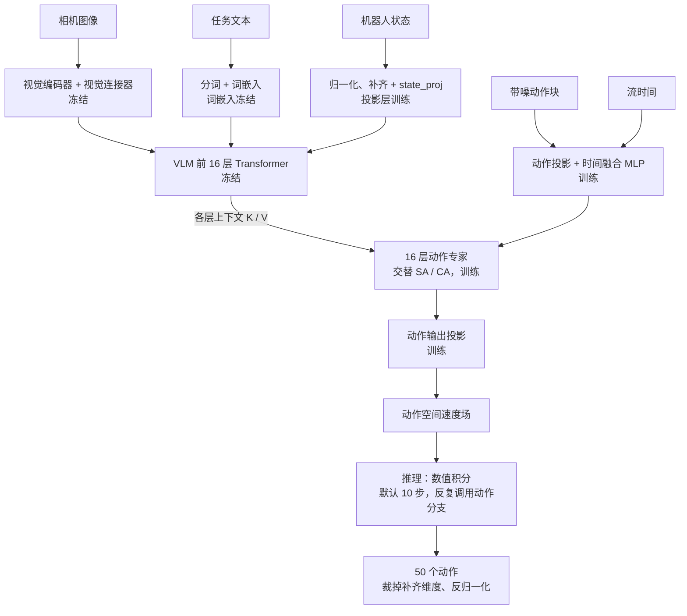

# SmolVLA：模型架构、训练与推理

核实日期：2026-10-14。本文解释 SmolVLA 的模块、张量接口、训练与推理差异，以及本仓库的微调范围；部署与运行命令分别见[训练项目](../experiments/training/README.md)和[推理项目](../experiments/inference/README.md)。

## 1. 适用版本与资料来源

本文使用以下资料，分别说明模型设计、代码实现和本项目配置：

| 层次 | 依据 | 涉及内容 |
| --- | --- | --- |
| 设计原理 | [SmolVLA 技术报告，arXiv v1，2025-06-02][paper]及[作者官方介绍][blog] | VLM 与动作专家的组合方式及设计取舍 |
| 具体实现 | LeRobot v0.6.1 的[模型实现][model]、[双分支 Transformer][expert]和[公共辅助函数][utils] | 注意力、投影、掩码与生成流程；实现细节以该版本代码为准 |
| 本项目适配 | [训练配置](../experiments/training/configs/smolvla-so100.toml)、[共享模型适配](../packages/smolvla_common/src/smolvla_common/runtime.py) | 实际设置的微调开关、动作块长度、资产冻结与输入特征适配 |

本文的 960／720 隐藏维度、32 维状态／动作容量等数值，来自核实时可读取的[公开 base 配置][base-config]与[骨干配置][backbone-config]。这些链接指向可变的 `main`。本次整理未读取到本机训练的 `prepared.json`，因此尚未核对具体训练运行使用的资产 SHA。实际运行的参数以准备记录和本地 checkpoint 配置为准。

## 2. 模型组成

SmolVLA 是条件动作生成模型，由视觉语言骨干 VLM、动作专家 Transformer，以及状态和动作投影层组成。动作专家（Action Expert）是原论文对动作生成分支的名称。

- VLM 把图像、语言和接入的机器人状态处理成上下文特征。
- 动作专家利用上下文，预测带噪动作块在生成过程中的变化方向。
- 数值积分把噪声转换成连续动作块，后处理再恢复数据集原始动作尺度。

两条 Transformer 分支按层传递内部特征，动作生成路径中没有文字计划解码步骤。[架构设计 §3.1][paper]

下图对应公开 base 架构及本项目默认微调配置。“训练／冻结”标记参数是否更新；推理时两类模块均参与计算。

## 3. 输入输出与参数配置

设批量大小为 $B$，相机数量为 $N_c$，真实状态与动作维度分别为 $D_s$、$D_a$，动作块长度为 $K$。本项目从数据 metadata 读取相机配置、状态维度和动作维度。

| 对象 | 形状或含义 | 公开 base 配置示例 |
| --- | --- | --- |
| 当前图像 | 每个相机一组 $B\times3\times H\times W$ 张量 | 模型内部缩放、补边到 $512\times512$ |
| 当前状态 | $B\times D_s$ | 补齐到 32 维，再投影为一个 960 维 token |
| 任务文本 | token ID 与有效位掩码 | 最大文本长度 48，具体有效长度由分词决定 |
| 上下文隐藏宽度 | VLM 每个 token 的特征维度 | 960 |
| 动作专家隐藏宽度 | 每个动作 token 的特征维度 | $0.75\times960=720$ |
| 示范动作块 | $B\times K\times D_a$ | $K=50$，内部动作维度补齐到 32 |
| 生成结果 | $B\times K\times D_a$ | 裁掉内部补齐维度，再由处理器反归一化 |

以上尺寸对应[base 配置][base-config]、[骨干配置][backbone-config]与[投影层构建逻辑][model]。内部状态和动作容量均为 32；实际维度较小时补零，超过容量时本项目报错停止。

三个配置项分别控制动作块长度、积分步数和训练更新次数：

- `chunk_size=50`：每个动作块包含 50 个动作位置。
- `num_steps=10`：每次动作块生成执行 10 次流积分更新。
- `training.steps=20000`：训练过程中执行 20,000 次优化器更新。

第一个动作位置对应数据窗口的当前时刻；窗口索引为 $0,\ldots,K-1$，共 $K$ 个位置。[官方策略配置][policy-config]

## 4. VLM 上下文编码

### 4.1 图像分支

SmolVLA 使用 SmolVLM2 骨干，其视觉部分采用 SigLIP 路线。图像先缩放补边，再经视觉编码器和视觉连接器生成 token。视觉分支输出直接参与上下文编码。

公开配置的图像尺寸为 $512\times512$、patch 边长为 16，因此初始空间网格为：

$$
\frac{512}{16}\times\frac{512}{16}=32\times32=1024
$$

随后按空间因子 4 重排，将网格变成 $8\times8=64$ 个视觉 token，再映射到语言分支所需宽度。每个 token 包含重排后的区域特征。SmolVLA 使用各相机的全局图像，省去骨干预训练时的多裁剪图像输入。[骨干配置][backbone-config]、[官方视觉 token 说明][blog]

不同相机图像独立经过共享的视觉编码器，随后在 token 序列中拼接。视觉分支输出学习得到的特征向量，未设置物体坐标、分割图或抓取点输出接口。

本项目将视觉归一化类型设为 `IDENTITY`，跳过基于训练数据统计量的视觉均值／标准差归一化。模型内部执行图像缩放及从 $[0,1]$ 到 $[-1,1]$ 的数值变换。[图像预处理实现][model]

### 4.2 语言分支

任务文本先经 tokenizer 变成 token ID，再由词嵌入层变成向量。官方处理器还负责末尾换行、padding、有效位掩码及设备搬移。本项目将 tokenizer 定位到准备阶段冻结的本地资产，避免运行时重新跟随远程版本。[处理器实现][processor]、[训练适配](../experiments/training/smolvla_training/training.py)

词嵌入向量与视觉、状态 token 一起参与 Transformer 上下文计算。该路径未执行文本解码。未见任务上的语言泛化能力需要单独评估。

### 4.3 保留部分语言层

公开骨干的文本 Transformer 有 32 层，base 策略配置在构建模型时保留前 16 层。动作专家使用对应层的上下文特征。减少保留层数可降低模型计算量。[骨干配置][backbone-config]、[base 配置][base-config]

## 5. 状态投影层 `state_proj`

`observation.state` 提供机器人本体状态，补充图像中的环境信息。其字段、顺序和物理单位由数据接口定义。

状态先使用训练侧统计量归一化、补齐到模型容量，然后通过线性层：

$$
e_s=W_s\tilde{s}+b_s
$$

$\tilde{s}$ 是补齐后的状态，$W_s,b_s$ 是可训练参数，$e_s$ 是一个与 VLM 隐藏宽度一致的状态 token。公开配置对应 $32\rightarrow960$，该 token 接在图像和语言 token 后面，进入 VLM 分支。[状态接入实现][model]

该线性层的参数通过训练更新，用于将数值状态映射到 VLM 的特征空间。输入字段顺序、单位和归一化方式由数据处理与硬件适配代码保证。

状态归一化与动作归一化的统计量分别来自训练集，验证与推理沿用这些记录。具体统计与协议见[数据准备](../experiments/training/smolvla_training/data.py)和[共享运行接口](../packages/smolvla_common/src/smolvla_common/runtime.py)。

## 6. 动作专家：连续动作 token 与交替注意力

### 6.1 动作表示与时间编码

一个动作块由 $K$ 个连续动作向量组成。每个动作 token 对应一个时刻的完整动作向量，其中各分量对应数据集定义的动作轴。

动作专家接收当前带噪动作块和流时间 $\tau$。动作输入投影把内部动作向量映射到专家隐藏宽度；流时间经正弦／余弦编码，与动作表示拼接后通过两层 MLP 融合。$\tau$ 是流积分的时间变量，用于表示噪声到动作转换的阶段。[动作输入与时间融合][model]、[时间编码][utils]

动作专家采用 Transformer 结构。其层数在公开 base 配置中与保留的 VLM 层数相同，隐藏宽度为 VLM 的 75%。`num_expert_layers=0` 表示沿用保留的 VLM 层数，此配置下为 16 层。[专家构建逻辑][expert]

### 6.2 交叉注意力（CA）

交叉注意力（Cross-Attention，CA）使用动作分支的查询向量和上下文的键、值向量。省略多头、位置编码等细节，计算形式为：

$$
\operatorname{Attention}(Q,K,V)
=\operatorname{softmax}\left(\frac{QK^\top}{\sqrt{d_k}}+M\right)V
$$

$Q$ 来自动作分支，上下文 K/V 经投影适配后参与计算，$M$ 为注意力掩码。动作专家与 VLM 分别使用各自的投影和前馈参数。[双分支注意力实现][expert]

### 6.3 自注意力（SA）

自注意力（Self-Attention，SA）计算动作位置之间的特征关联。按公开配置，零基偶数层进入 SA 分支，奇数层进入 CA 分支；一基编号下的第 1、3、5……层为 SA，第 2、4、6……层为 CA。

v0.6.1 的 SA 分支拼接上下文和动作的 K/V，动作位置的注意力计算同时包含上下文与动作特征。CA 分支仅使用上下文 K/V。[逐层分支选择][expert]

### 6.4 掩码与并行计算

联合 SA 的掩码允许关系如下，padding 位置另由有效位掩码排除：

| 查询位置 | 图像／语言 | 状态 | 动作位置 |
| --- | --- | --- | --- |
| 图像／语言 token | 可见 | 不可见 | 不可见 |
| 状态 token | 可见 | 自身可见 | 不可见 |
| 动作 token $i$ | 可见 | 可见 | 第 $0$ 到第 $i$ 个可见，后续不可见 |

表格针对联合 SA；CA 层没有动作之间的注意力边。掩码由 token 分组标记累加生成。[掩码辅助函数][utils]

每次前向并行计算整个动作块，因果掩码限制动作位置之间的注意力连接。整个动作块通过流积分反复更新。动作执行和可行性检查由后续控制系统处理。

## 7. Flow Matching 训练与推理

### 7.1 为什么从随机噪声生成动作

从噪声生成动作是 SmolVLA 的模型设计选择。直接根据图像、机器人状态和任务文本预测动作也可行。设 $C$ 为这些观测条件，$A$ 为有时间顺序的动作块，两种方式可简化为：

$$
\text{直接回归：}\quad \hat A=f_\theta(C)
$$

$$
\text{条件生成：}\quad \hat A=G_\theta(C,\epsilon),
\qquad \epsilon\sim\mathcal N(0,I)
$$

这里的 $G_\theta$ 表示完整采样过程，包括多次调用动作专家和数值积分；SmolVLA 神经网络每次输出的是动作变量的变化率。动作块是连续数值构成的序列，其位置具有时间顺序。[SmolVLA 动作专家设计][paper]、[生成实现][model]

引入生成式建模的一项动机是：同一观测条件可能对应多种合理的动作序列，称为多模态动作分布。假设机械臂需要绕过中间的障碍物，示范中从左绕和从右绕各占一半。在两条路径的同一个中间时刻，可以构造如下教学例子：

| 方案 | 假设的横向位置 | 含义 |
| --- | --- | --- |
| 从左绕 | $-1$ | 一种可行路径 |
| 从右绕 | $+1$ | 另一种可行路径 |
| 两者平均 | $0$ | 在这个例子中经过障碍物 |

在同一条件下，直接回归若使用平方误差，理想最优输出是示范动作的条件均值。因此，两种可行方案的平均可能不可行。条件生成模型希望学习合理动作的分布，再从中生成一种方案；[Diffusion Policy 的 IJRR 2024 论文及作者说明][diffusion-policy]讨论了多模态动作分布这一动机。上述左右绕障只是解释平均值问题的假设例子，不是本仓库实测，也不证明 SmolVLA 有避障能力。

“随机数里怎么会有指令”可以通过区分三类信息来理解：

| 信息 | 提供什么 | 在本实现中的位置 |
| --- | --- | --- |
| 图像、状态与任务文本 $C$ | 当前环境、机器人状态和任务条件 | VLM 上下文及其 K/V 特征 |
| 训练后的参数 $\theta$ | 在这些条件下生成动作的规则 | 动作专家、投影层等模型参数 |
| 随机噪声 $\epsilon$ | 从简单分布采样得到的生成起点 | 与内部动作块同形状的数值张量 |

标准正态分布容易采样；训练让模型学会在观测条件下，将这个简单分布逐步变换为动作分布。噪声本身不包含“抓杯子”等任务语义。不同起点可能产生不同方案，具体结果仍取决于条件与训练后的模型。生成多种方案也可采用其他模型形式，从噪声生成并非唯一办法。[条件动作生成设计][blog]

本项目离线评估用固定种子加全局帧号生成噪声，使基础模型和微调模型获得相同初值。需要噪声输入不等于每次必须换一个不可复现的随机起点；固定种子用于控制比较条件。[本项目噪声采样](../experiments/inference/smolvla_inference/engine.py)

### 7.2 训练、推理与其他模型的区别

训练与推理使用同一个速度场模型，但计算任务不同：

| 对比项 | 训练前向 | 推理生成 |
| --- | --- | --- |
| 已知输入 | 观测条件与真实示范动作块 | 观测条件 |
| 噪声如何参与 | 为每个示范动作块采样噪声和一个流时间，构造带噪中间位置 | 采样纯噪声作为起点 |
| 一次前向预测什么 | 这个中间位置上的动作变化率 | 当前积分位置上的动作变化率 |
| 后续计算 | 与已知监督目标比较，反向传播并更新可训练参数 | 通过积分更新动作块，再调用模型，直到完成生成 |
| 本项目的次数设置 | `training.steps` 是优化器更新次数 | `num_steps=10` 是每个动作块的积分次数 |

一次普通训练前向对每个示范动作块只采样一个流时间并预测速度场，随后由训练循环计算梯度与更新参数。它不需要先跑完 10 步积分再与示范动作比较；推理时才沿多个流时间反复计算。不同训练更新会覆盖不同的噪声和中间阶段。[训练前向与采样路径][model]、[本项目训练适配](../experiments/training/smolvla_training/training.py)

SmolVLA 也用平方误差，但回归对象是给定 $x_\tau,\tau,C$ 时的速度场，而非仅给定 $C$ 时的完整示范动作。它学习不同中间位置上的变化规则，再通过积分构成生成过程；这不能等同于把不同完整动作序列直接求平均。

较早的机器人学习模型也使用随机变量，差别在于随机变量的用途和输出方式：

| 方法与依据 | 训练中的随机变量 | 推理时如何输出动作 |
| --- | --- | --- |
| 直接回归，如 CNN／MLP 动作头 | 不要求引入生成用的噪声或潜变量 | 一次前向直接预测动作或动作块 |
| [ACT，原版 RSS 2023][act] | CVAE 编码器根据示范动作和状态产生分布，并采样潜变量 $z$ | 去掉 CVAE 编码器，将 $z$ 设为先验均值 0，再直接解码动作块 |
| [Diffusion Policy，RSS 2023／IJRR 2024][diffusion-policy] | 对示范动作加噪，学习去噪生成 | 从噪声开始，经过多次去噪生成动作序列 |
| SmolVLA，LeRobot v0.6.1 [源码][model] | 将示范动作与噪声混合，学习速度场 | 从噪声开始，通过多步流积分生成动作块 |

动作块预测与噪声生成是两个不同选择：ACT 和 SmolVLA 都预测动作块，但生成方式不同。Flow Matching 的多步生成增加推理计算量；其效果与数据、模型容量及采样设置有关，不是对所有任务都优于直接回归的保证。

### 7.3 训练：学习速度场

以下采用 v0.6.1 代码中的时间方向。设 $A$ 为归一化后的示范动作块，$\epsilon$ 为同形状噪声，$C$ 为观测上下文：

$$
x_\tau=(1-\tau)A+\tau\epsilon,
\qquad
u_\tau=\epsilon-A
$$

模型预测 $v_\theta(x_\tau,\tau;C)$，以它与 $u_\tau$ 的平方差训练。$\tau=0$ 对应示范动作，$\tau=1$ 对应噪声。实际实现还裁掉非真实动作维度，并对轨迹尾部的填充位置做掩码与有效元素归约。[训练前向实现][model]

训练时，示范动作参与构造监督样本；推理时，策略条件仅包含当前观测与任务文本。离线评估中的示范动作仅用于计算误差。

### 7.4 推理：从噪声积分到动作

推理先采样 $x_1$，然后用 Euler 方法从流时间 1 积分到 0：

$$
\Delta\tau=-\frac{1}{N},
\qquad
x_{\tau+\Delta\tau}
=x_\tau+\Delta\tau\,v_\theta(x_\tau,\tau;C)
$$

本项目默认 $N=10$，对应 $\Delta\tau=-0.1$。每步增量为预测速度场与负时间步长的乘积。速度场表示动作变量对流时间的导数，其数值含义由上述生成过程定义。[官方积分器][flow]

每次积分更新内存中的整个动作块。生成结束后去掉内部补齐维度，再通过保存的动作统计量反归一化。[模型输出][model]、[后处理器][processor]

### 7.5 K/V 缓存与动作队列

同一观测下，上下文不依赖带噪动作，可以预先计算各层 K/V，在多次积分更新中复用；新观测到来时需要重新编码。K/V 缓存保存注意力计算的中间特征，动作队列保存已生成的动作。[生成与 K/V 复用][model]

`predict_action_chunk()` 返回整个动作块；上游的 `select_action()` 管理动作队列并逐次取用。当前项目的离线推理与实时输入诊断将动作保存为文件，未接入动作下发与异步执行流程；共享配置关闭 RTC。运行方式见[推理说明](../experiments/inference/README.md)。

## 8. 参数更新与梯度计算

本项目默认 `train_expert_only=true`、`freeze_vision_encoder=true`、`train_state_proj=true`。实际含义如下：

| 参数组 | 是否更新 | 职责 |
| --- | --- | --- |
| 视觉编码器、视觉连接器、语言嵌入和保留的 VLM 层 | 否 | 提供已预训练的上下文处理能力 |
| `state_proj` | 是 | 把机器人状态映射为上下文 token |
| 动作专家的有效参数 | 是 | 在观测条件下预测动作速度场 |
| 动作输入／输出投影、动作时间融合 MLP | 是 | 连接动作数值空间与专家隐藏空间 |

`train_expert_only` 控制双分支模块内部的 VLM 参数冻结。状态投影、动作输入／输出投影和时间融合 MLP 的参数状态分别设置。[冻结实现][expert]、[本项目配置适配](../packages/smolvla_common/src/smolvla_common/runtime.py)

### 8.1 冻结参数时的梯度计算

以简化函数说明：

$$
C=g_\phi(I,L,W_s\tilde{s}+b_s),
\qquad
v=f_\theta(x_\tau,\tau;C)
$$

冻结 $\phi$ 后，优化器保持 VLM 参数不变。损失通过固定函数 $g_\phi$ 对状态输入求导，梯度继续传递到 $W_s,b_s$，用于更新状态投影参数。

相关 PyTorch 设置的作用如下：

- 参数的 `requires_grad=False`：关闭该参数的梯度计算；对需要梯度的输入仍保留求导路径。
- `eval()`：切换 dropout 等模块的运行模式，自动求导设置保持不变。
- `torch.no_grad()`：关闭该作用域内的自动求导记录；用于整个 VLM 前向时，会阻断经该前向传递到状态投影的梯度。

根据上述梯度路径，冻结骨干可减少其参数梯度与优化器状态开销，但向状态投影反向传播时仍需保存相关中间激活。具体显存占用需要实测。

### 8.2 预训练权重加载

本项目先依据冻结的骨干配置初始化结构，再通过 `SmolVLAPolicy.from_pretrained(..., strict=True)` 加载完整 SmolVLA checkpoint。该 checkpoint 包含骨干权重；`load_vlm_weights=False` 用于跳过单独加载 VLM 权重的步骤。[本地加载代码](../packages/smolvla_common/src/smolvla_common/runtime.py)

动作专家同样从完整策略 checkpoint 加载预训练权重，随后在公开示范数据上更新参数。

## 9. 控制接口与验证状态

| 层次 | 本项目中承担的工作 | 输出或验证内容 |
| --- | --- | --- |
| 学习模型 | 观测条件编码、状态表征、连续动作生成 | 数据集定义的连续动作向量 |
| 确定性处理 | 分词、缩放、归一化、补齐、掩码、流积分、反归一化 | 模型输入张量及恢复原始尺度的动作 |
| 训练工程 | 数据划分、版本冻结、优化与 checkpoint 管理 | 模型文件、训练状态及留出集 loss |
| 硬件执行 | 当前训练与推理入口均未实现动作下发 | 单位适配、限位和执行控制需要另行实现与验证 |

接入执行系统时，需要核对动作向量的关节顺序、绝对／增量含义、单位和控制模式。IK、位置控制、力矩控制等模块的选择取决于策略动作接口和硬件接口。

其他系统的模块划分可参见 [Gemini Robotics 官方介绍][gemini]：VLA 模型负责动作控制，ER 模型负责具身推理与规划。本文所述 SmolVLA 实现包含动作策略，未集成独立的上层任务规划器；两者内部结构的对应关系尚未核实。

以下仍需由具体实验核实：基础模型与训练数据是否重叠；新相机／机器人状态的语义兼容；语言泛化；闭环任务成功率；执行时延、限位与停止机制。本次只整理源码与公开资料，没有重新训练、运行模型或连接硬件；已有验收记录以对应项目 README 为准。

## 10. 对照代码的阅读顺序

| 顺序 | 入口 | 重点 |
| --- | --- | --- |
| 1 | [本项目 TOML](../experiments/training/configs/smolvla-so100.toml) | 动作块长度、积分步数与训练开关 |
| 2 | [共享 `make_policy_config()` / `load_policy()`](../packages/smolvla_common/src/smolvla_common/runtime.py) | 基础配置如何被数据 schema 和本地资产覆盖 |
| 3 | [官方 `VLAFlowMatching`][model] | 投影层、`embed_prefix()`、`embed_suffix()`、训练前向与动作采样 |
| 4 | [官方 `SmolVLMWithExpertModel`][expert] | 两条分支、逐层注意力、权重冻结 |
| 5 | [掩码与编码工具][utils]、[积分器][flow] | 哪些 token 可互见，速度场如何转换为动作 |
| 6 | [本项目训练适配](../experiments/training/smolvla_training/training.py)与[离线推理引擎](../experiments/inference/smolvla_inference/engine.py) | 模型如何接入训练循环与不执行动作的评估流程 |

[paper]: https://arxiv.org/html/2506.01844v1#S3.SS1
[blog]: https://huggingface.co/blog/smolvla
[base-config]: https://huggingface.co/lerobot/smolvla_base/blob/main/config.json
[backbone-config]: https://huggingface.co/HuggingFaceTB/SmolVLM2-500M-Video-Instruct/blob/main/config.json
[model]: https://github.com/huggingface/lerobot/blob/v0.6.1/src/lerobot/policies/smolvla/modeling_smolvla.py
[expert]: https://github.com/huggingface/lerobot/blob/v0.6.1/src/lerobot/policies/smolvla/smolvlm_with_expert.py
[utils]: https://github.com/huggingface/lerobot/blob/v0.6.1/src/lerobot/policies/common/vla_utils.py
[flow]: https://github.com/huggingface/lerobot/blob/v0.6.1/src/lerobot/policies/common/flow_matching.py
[processor]: https://github.com/huggingface/lerobot/blob/v0.6.1/src/lerobot/policies/smolvla/processor_smolvla.py
[policy-config]: https://github.com/huggingface/lerobot/blob/v0.6.1/src/lerobot/policies/smolvla/configuration_smolvla.py
[gemini]: https://deepmind.google/models/gemini-robotics/
[act]: https://tonyzhaozh.github.io/aloha/
[diffusion-policy]: https://diffusion-policy.cs.columbia.edu/
